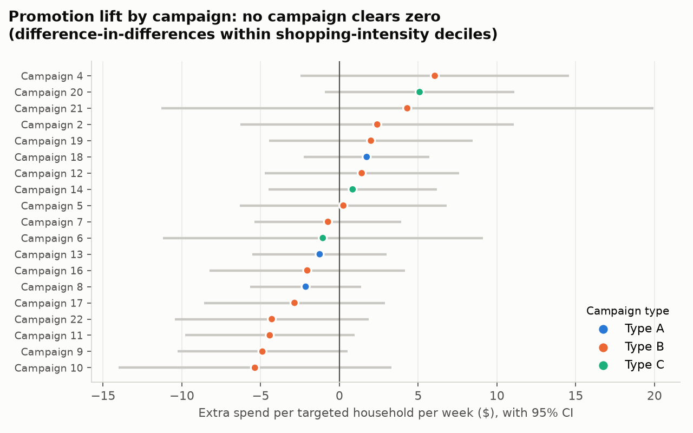
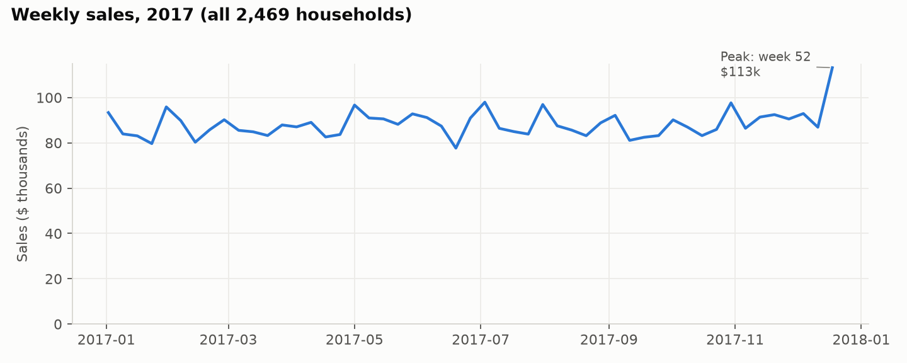
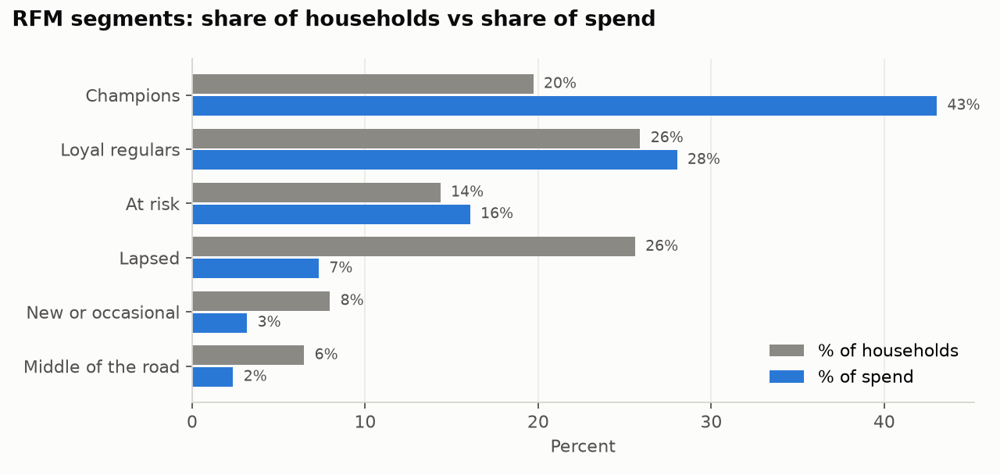
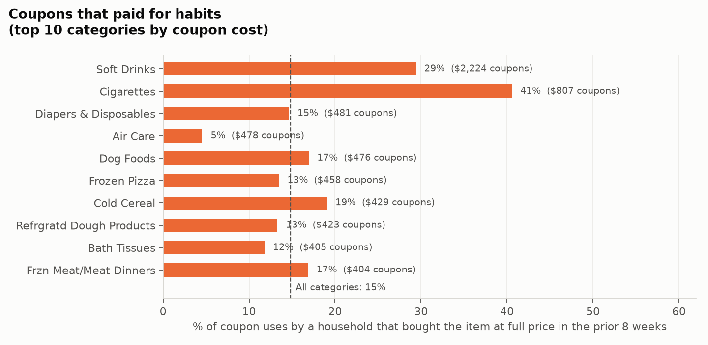
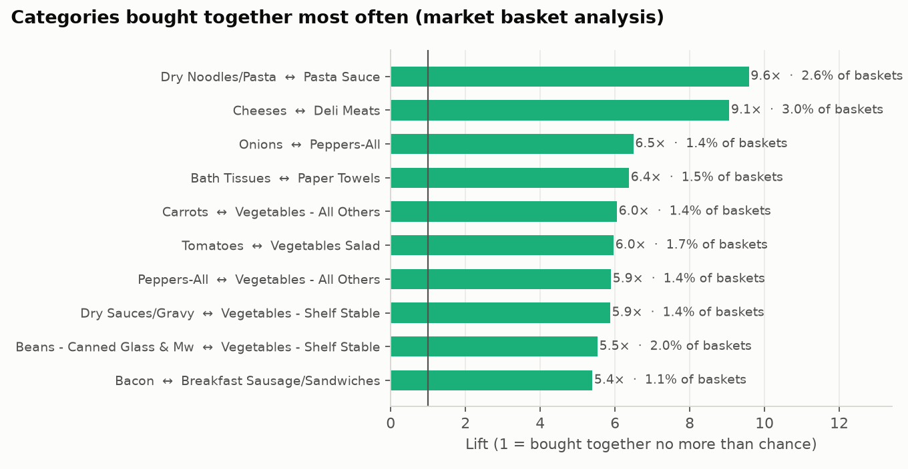

# Retail promotions and basket analysis

**Which promotions actually grow a household's spend?** In a year of grocery data for 2,469 households, **none of 19 testable marketing campaigns produced a measurable lift in total household spend**. Meanwhile shelf discounts on soft drinks alone gave away **$61k, a third of the category's revenue**.



## Key findings

- **Campaigns don't grow the basket.** Like-for-like difference-in-differences across 19 campaigns: 0 significant at 5%. The three mass "Type A" mailings (about 1,050 households each) averaged **−0.9%**. A placebo test on pre-campaign windows is also clean (0 of 19), so the method isn't hiding a real effect. **→ Run every future campaign with a random 10% holdout so lift is measured, not assumed.**
- **Soft drinks are discount-dependent.** **71% of soft-drink units sell on a shelf discount**, costing $60.9k on $182k revenue. Coupons in this category go to households who already bought the item at full price **twice as often as average (29% vs 15%)**. **→ Cut discount depth or frequency on soft drinks first. It is the biggest pool of margin spent on habitual purchases.**
- **Some pairs sell themselves.** **45% of baskets with dry pasta also contain pasta sauce (lift 9.6×)**, and 63% of deli-cheese baskets include deli meat (lift 9.1×). **→ Discount one side of a strong pair, keep the partner at full price, and place them together. Don't fund both.**

Also useful: **Champions are 20% of households but 43% of spend** (RFM). The average basket is **$29.49**.

## Approach

1. **Data:** dunnhumby [*The Complete Journey*](https://www.dunnhumby.com/source-files/), 2017 release (1.47M transactions, 155,848 baskets, 27 campaigns, coupon redemptions, 21M store-level promotion rows), loaded into **SQLite** ([`src/load_to_sqlite.py`](src/load_to_sqlite.py)).
2. **SQL first:** profiling, baseline KPIs, RFM scoring with window functions, and DiD inputs are all in [`sql/`](sql/) as named queries.
3. **Promotion lift:** for each campaign, weekly spend *during* vs an equal-length window *before*, targeted vs non-targeted households. Targeted households shop about twice as much as the rest, so the comparison is made **within shopping-intensity deciles**. 95% CIs and a placebo test check that the method isn't inventing effects.
4. **Habit subsidy:** for every coupon-discounted line, did that household buy the same product at full price in the previous 8 weeks?
5. **Market basket:** FP-growth association rules (support, confidence, lift) on 137k baskets × 154 categories.

## Results

| | |
|---|---|
|  |  |
|  |  |

Full walkthrough: [`notebooks/analysis.ipynb`](notebooks/analysis.ipynb). Every number above is in [`results/findings.json`](results/findings.json).

## Limitations and next steps

- Campaign targeting isn't random. Comparing within deciles helps, but households may have been picked on signals the data doesn't show. A proper holdout test is the real fix, which is recommendation 1.
- This is the 1-year (2017) release, so campaigns starting in January have no pre-window and were excluded. The original 2-year release would allow seasonal controls.
- Lift is measured on *total* spend. A campaign could still shift brand share inside a category; that's the next cut to make.

## How to run

```bash
pip install -r requirements.txt
./run_all.sh
```
